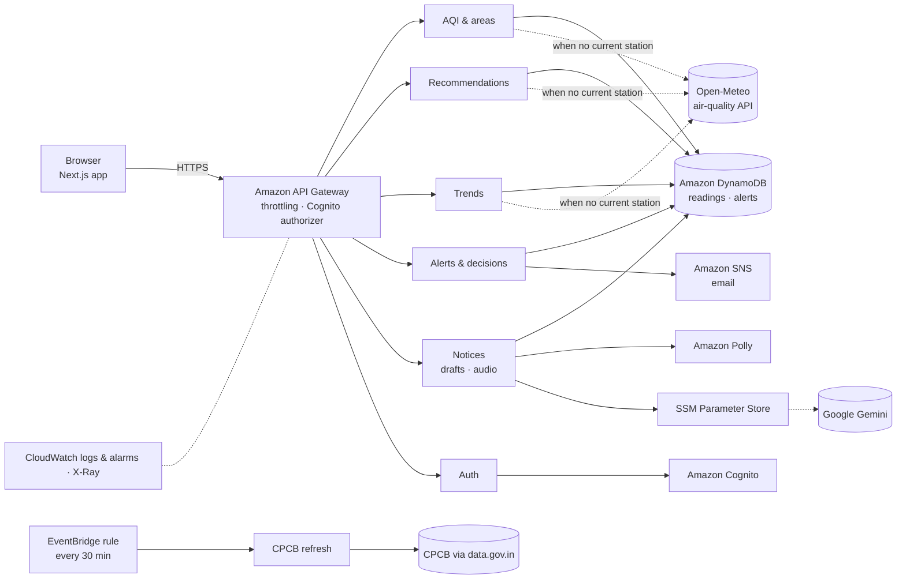

# BreatheSafe Campus

**From an air-quality reading to a campus decision in under a minute — with an audit trail.**

Built for the **WeMakeDevs × AWS Environmental Hacks** (Air track).

Every October–November, schools and colleges across north India face hazardous air. Administrators
can look up an AQI number, but the number doesn't tell them *what to do*, help them *tell everyone*,
or *record* the decision they took. BreatheSafe Campus closes that gap with one workflow:

> **See → Act → Record**
>
> 1. **See** — the AQI for your location, with a plain-language CPCB-based recommendation and the evidence behind it.
> 2. **Act** — issue a bilingual (English + Hindi) alert to students, staff or parents: in-app notice, email, WhatsApp share and a spoken PA announcement.
> 3. **Record** — log the decision taken (e.g. "Moved activities indoors"). Every alert keeps a snapshot of the reading it was based on.

---

## Features

- **Location-aware AQI** — detects the user's location (rounded to ~1 km, never stored) and shows the AQI for that area anywhere in India; a searchable area picker if location is denied.
- **Indian AQI, computed the CPCB way** — 24-hour averages for PM2.5, PM10, NO₂, SO₂, NH₃ and 8-hour averages for O₃ and CO; the AQI is the highest sub-index. Six CPCB categories, Good → Severe.
- **Deterministic recommendations** — a transparent rules engine (no ML); every recommendation shows the rule, value, pollutant, source and time.
- **Honest data states** — *Live*, *Cached* (≤3 h, labelled), *Stale* warnings, *Unavailable* (never a fake number), and clearly labelled *Demo* data.
- **Bilingual notices** — reviewed English + Hindi templates per category; optional AI rephrasing (Google Gemini) guarded so it can't change numbers or drop the location.
- **Delivery** — in-app public notice page (shareable link per area), email via Amazon SNS (recorded only when actually delivered), WhatsApp share, Amazon Polly audio in English and Hindi.
- **Audit trail** — alerts snapshot the exact reading; decisions are append-only and record who decided, from the verified sign-in.
- **Presenter mode** — `?presenter=1` reveals a labelled demo-scenario control for presentations.

## Architecture



See [ARCHITECTURE.md](ARCHITECTURE.md) for the data model, data-source selection, security and observability.

### AWS services

| Service | What it does here |
|---|---|
| API Gateway | REST API; Cognito authorizer on write routes; throttling (20 rps, burst 40) |
| Lambda (Node.js 22, arm64) | 7 functions — AQI/areas, recommendations, trends, alerts/decisions, notices, auth, scheduled CPCB refresh |
| DynamoDB | AQI readings (8-day TTL) and the alert/decision audit trail (deletion protection, PITR) |
| Cognito | Administrator accounts |
| SNS | Alert emails; operational alarm emails |
| Polly | Spoken English/Hindi notices |
| EventBridge (scheduled rule) | CPCB refresh every 30 minutes |
| SSM Parameter Store | Encrypted third-party API keys |
| CloudWatch & X-Ray | 14-day logs, 6 alarms, tracing |
| SAM / CloudFormation | All infrastructure as code ([infrastructure/template.yaml](infrastructure/template.yaml)) |

## Data sources and limitations

- **CPCB monitoring stations** (data.gov.in) are used when a station near the user reported within 3 hours. *(At the time of writing, CPCB's public feed has been unavailable since 7 October 2026; the app falls back automatically.)*
- **Open-Meteo air-quality data** (Copernicus CAMS, ~11 km grid) otherwise — so every location in India gets a reading.
- Readings are area-level, not street-level, and can differ from other apps. This is **decision support, not medical advice**, and does not replace official CPCB or health-authority advisories.
- No student health data is collected. See the in-app **About** page for the full privacy note.

## Repository layout

```
backend/
  shared/src/      rules engine, AQI maths, areas, data sources, notice templates
  services/*/src/  one folder per Lambda (aqi-data, recommendation, trends, alerts, notices, auth)
  tests/           Vitest unit tests
frontend/          Next.js app (dashboard, alerts log, public notice, about, auth)
infrastructure/    SAM template + samconfig (dev and prod stacks)
```

## Getting started

**Prerequisites:** Node.js 22+, npm, and for deploying: AWS CLI + AWS SAM CLI.

```bash
npm run install:all     # backend + frontend dependencies
npm test                # backend unit tests (Vitest)
npm run typecheck       # backend + frontend
npm run lint            # frontend ESLint
```

### Run the frontend

```bash
cp frontend/.env.example frontend/.env.local   # set NEXT_PUBLIC_API_URL (or leave unset for the public demo API)
npm run dev                                    # http://localhost:3000
```

### Deploy your own backend

```bash
cd infrastructure
sam build
sam deploy --guided --parameter-overrides "DataMode=live Stage=prod AlertEmail=you@example.com"
```

Optional keys (stored by you in SSM Parameter Store, never in code):

```bash
aws ssm put-parameter --name /breathesafe/gemini-api-key --type SecureString --value "<key>"   # AI notice drafts (Gemini free tier)
```

Key parameters: `DataMode` (`live` / `demo`), `AlertEmail` (SNS email; confirm the subscription email AWS sends), `CpcbApiKey` (data.gov.in key, optional), `NoticeAIEnabled`, `PublicSiteUrl`. Use `--config-env dev` for the separate dev stack defined in `samconfig.toml`.

## AI tools used

- **Claude Code (Anthropic)** — used during development for auditing the codebase and infrastructure, implementing features, and writing tests.
- **Google Gemini API** — used at runtime (free tier) to optionally rephrase notice drafts; guarded by a faithfulness check with the reviewed template as fallback.

## Project documents

- [Product requirements (PRD)](BreatheSafe_Campus_PRD_v2.md) and [build phases](BUILD_PHASES.md) — original planning documents.
- [ARCHITECTURE.md](ARCHITECTURE.md) — system design as built.
