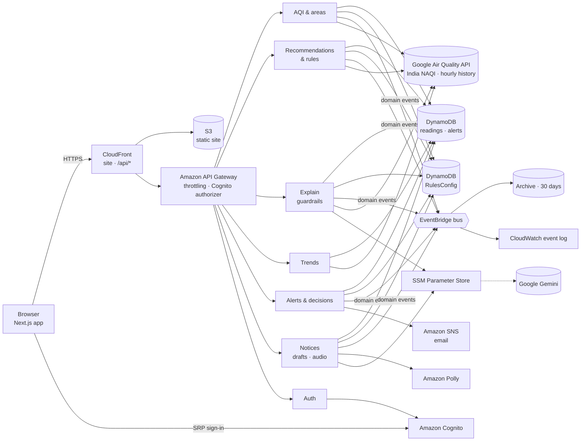

# VayuSaathi

**Air quality you can act on — for anyone in India.** *Vayu* (वायु) is air, *saathi* (साथी) a companion.

Built for the **WeMakeDevs × AWS Environmental Hacks** (Air track) by team **Waterpark Enthusiasts**:
Chaitanya Saagar, Parul Garg, Nakshatra Kanchan and Divyansh Gupta.

Every October–November, air across north India turns Poor or Severe. Anyone can look up an AQI
number, but the number doesn't tell you *what to do*, help you *warn the people you care about*,
or *remember* what you decided. VayuSaathi closes that gap with one workflow:

> **See → Act → Record**
>
> 1. **See** — the AQI where you are, with a plain-language recommendation, the evidence behind it, and an "Explain in plain language" button (English or Hindi).
> 2. **Act** — share a bilingual (English + Hindi) alert with your family, neighbourhood, team or everyone: a public notice page, email, WhatsApp and a spoken version.
> 3. **Record** — note what you decided (e.g. "Moved plans indoors"). Every alert keeps a snapshot of the reading it was based on.

No account is needed to check the air; you sign in only to share alerts.

---

## Features

- **Location-aware AQI** — detects your location (rounded to ~1 km, never stored) and shows the AQI for that area anywhere in India; a searchable area picker if location is denied.
- **Indian AQI, computed the CPCB way** — 24-hour averages for PM2.5, PM10, NO₂, SO₂, NH₃ and 8-hour averages for O₃ and CO; the AQI is the highest sub-index. Six CPCB categories, Good → Severe.
- **Rules as data** — recommendations come from a deterministic rules engine whose bands and actions live in a DynamoDB **RulesConfig** table. Edits apply within five minutes, without a redeploy; an invalid edit is rejected by validation and the built-in rules are used instead.
- **Explain in plain language** — an AI explanation (Google Gemini) written only from evidence the server builds, shown only if it passes **output guardrails** (no invented numbers, no medical advice or safety promises, correct category, place and language). Otherwise a reviewed explanation is shown — and the page says which one you are reading.
- **My plans today** — add your outdoor plans (walk, run, kids' play, commute…) and get a deterministic **Go / Modify / Avoid** for each, from the current category, how strenuous and long the plan is, and whether someone more sensitive is involved.
- **Honest data states** — *Live*, *Cached* (≤3 h, labelled), *Stale* warnings, *Unavailable* (never a fake number), and clearly labelled *Demo* data.
- **Bilingual alerts** — reviewed English + Hindi templates per category and audience (family, neighbourhood, team/group, everyone), optionally polished by AI under a faithfulness check; signed with your name.
- **Delivery** — public notice page per area (shareable link), email via Amazon SNS (recorded only when actually delivered), WhatsApp share, Amazon Polly audio in English and Hindi.
- **Audit trail + domain events** — alerts snapshot the exact reading; decisions are append-only and record who decided. Readings, category changes, alerts and decisions are published as events on an **Amazon EventBridge** bus, archived for 30 days and replayable.
- **Validated everywhere** — every API input and the Google Air Quality response are checked with **Zod** schemas.
- **Safe to retry** — sharing an alert is idempotent (`Idempotency-Key`), so a double click or a network retry never sends the same alert twice; alert history is paginated.
- **Globe and nearby cities** — a rotatable globe and a "cities near you" list showing each Indian city's current AQI from the same source as the main reading, with an India AQI / US AQI switch.
- **Search any locality** — type "Lajpat Nagar" or "Koramangala" (Google Places autocomplete, India only); a detected location is named after its neighbourhood (Google Geocoding) instead of the nearest city.
- **SOS** — a red button on every page: one tap to call 112 / ambulance / fire / women's helpline, see the nearest hospitals with call and directions (Google Places), or call, SMS or WhatsApp your emergency contacts with your live location (or saved address) in the message. Messages open ready to send in the phone's own apps, so nothing is sent without you and there is no SMS cost.
- **Account settings** — profile photo (resized in the browser), name, phone (stored as E.164), address lines 1–2, and up to five emergency contacts, in a DynamoDB profiles table keyed by the user's Cognito id and readable only by that user.
- **Accounts** — **SRP sign-in** straight from the browser to Cognito (the password never leaves the device), sign-up with email verification (resend code), forgot/reset password, optional **two-step verification** with an authenticator app (TOTP), and sign-out that revokes the session; sign-in state stays in sync across tabs.
- **Observability** — structured JSON logs and business metrics (alerts, decisions, AI vs fallback explanations, unavailable readings) in CloudWatch via Embedded Metric Format.
- **Presenter mode** — `?presenter=1` reveals a labelled demo-scenario control for presentations.

## Architecture



See [ARCHITECTURE.md](ARCHITECTURE.md) for the data model, rules, events, guardrails, security and observability.

### AWS services

| Service | What it does here |
|---|---|
| API Gateway | REST API; Cognito authorizer on write routes; throttling (20 rps, burst 40) |
| Lambda (Node.js 22, arm64) | 7 functions — AQI/areas, recommendations/rules/plans, explanations, trends, alerts/decisions, notices, auth |
| DynamoDB | AQI readings (8-day TTL), the alert/decision audit trail (deletion protection, PITR), the RulesConfig table |
| EventBridge | Custom event bus for domain events, with a 30-day archive and a CloudWatch event log |
| Cognito | Accounts for people who share alerts |
| SNS | Alert emails; operational alarm emails |
| Polly | Spoken English/Hindi notices |
| SSM Parameter Store | Encrypted third-party API keys |
| CloudWatch & X-Ray | 14-day logs, 7 alarms, tracing |
| S3 + CloudFront | The website: a static Next.js export in a private bucket, served over HTTPS with security headers; `/api/*` is routed to API Gateway on the same address |
| SAM / CloudFormation | All infrastructure as code ([infrastructure/template.yaml](infrastructure/template.yaml)) |

## Data sources and limitations

- **Google Air Quality API** — real-time hourly air quality for any location in India, reported on India's National AQI (index `ind_cpcb`, the CPCB scale), with the dominant pollutant and concentrations; its hourly history drives the trend chart. Each area is looked up at most every 30 minutes (stored readings are reused), and if the API is briefly unavailable the last reading from the past 3 hours is shown, labelled *Cached*.
- **IQAir** (fallback) — when Google has no reading, IQAir's free `nearest_city` data is used. It reports only the US and China AQI and each one's main pollutant, so VayuSaathi **estimates** the Indian AQI (inverting each index to the concentration of its main pollutant, PM2.5, PM10 or ozone, and applying CPCB breakpoints) and labels it *Estimated*, with no pollutant breakdown.
- Readings are area-level, not street-level, and can differ from other apps. This is **decision support, not medical advice**, and does not replace official CPCB or health-authority advisories.
- No health data is collected. See the in-app **About** page for the full privacy note.

## Repository layout

```
backend/
  shared/src/      rules engine + RulesConfig loader, Zod schemas, events, AQI maths, areas, data sources, notice templates
  services/*/src/  one folder per Lambda (aqi-data, recommendation, explain, trends, alerts, notices, auth)
  scripts/         seed-rules.ts (seeds the RulesConfig table)
  tests/           Vitest unit and handler tests (AWS clients mocked)
frontend/          Next.js app (dashboard, alerts log, public notice, about, auth)
  e2e/             Playwright end-to-end test against a mocked API
infrastructure/    SAM template + samconfig (dev and prod stacks)
.github/workflows/ CI: typecheck, tests, lint, build, SAM validate + build
```

## Getting started

**Prerequisites:** Node.js 22+, npm, and for deploying: AWS CLI + AWS SAM CLI.

```bash
npm run install:all     # backend + frontend dependencies
npm test                # backend tests (Vitest)
npm run typecheck       # backend + frontend
npm run lint            # frontend ESLint
npm run test:e2e --prefix frontend   # Playwright (first time: npx playwright install chromium)
```

CI ([.github/workflows/ci.yml](.github/workflows/ci.yml)) runs the same checks plus a production build, the Playwright end-to-end test, `sam validate --lint` and `sam build` on every push and pull request.

### Run the frontend

```bash
cp frontend/.env.example frontend/.env.local   # API URL + Cognito pool/client ids of your stack (required)
npm run dev                                    # http://localhost:3000
```

### Deploy your own backend

```bash
cd infrastructure
sam build
sam deploy --guided --parameter-overrides "DataMode=live Stage=prod AlertEmail=you@example.com"
cd .. && npm run seed:rules        # seed the RulesConfig table (safe to re-run; --force overwrites edits)
npm run deploy:web                 # build the site and publish it to S3 + CloudFront (prints the URL)
```

Optional keys (stored by you in SSM Parameter Store, never in code):

```bash
aws ssm put-parameter --name /breathesafe/google-air-quality-key --type SecureString --value "<key>"   # live air quality (required for DataMode=live)
aws ssm put-parameter --name /breathesafe/gemini-api-key --type SecureString --value "<key>"          # AI drafts + explanations (Gemini free tier)
```

Key parameters: `DataMode` (`live` / `demo`), `AlertEmail` (SNS email; confirm the subscription email AWS sends), `GoogleAqKeyParam` (SSM name of the Google Air Quality key), `IqAirKeyParam` (SSM name of the IQAir key, default `/breathesafe/iqair-api-key`), `NoticeAIEnabled`, `ExplainAIEnabled`, `PublicSiteUrl`, `SesFromEmail` (optional verified SES sender for Cognito emails; needs SES production access). Use `--config-env dev` (and `npm run seed:rules:dev`) for the separate dev stack defined in `samconfig.toml`.

## AI tools used

- **Claude Code (Anthropic)** — used during development for auditing the codebase and infrastructure, implementing features, and writing tests.
- **Google Gemini API** — used at runtime (free tier) to optionally rephrase alert drafts and write plain-language explanations; both are checked automatically (faithfulness check / output guardrails) with reviewed text as the fallback.

## Project documents

- [Product requirements (PRD)](BreatheSafe_Campus_PRD_v2.md) and [build phases](BUILD_PHASES.md) — original planning documents (written when the product targeted campuses).
- [ARCHITECTURE.md](ARCHITECTURE.md) — system design as built.
- [docs/WRITEUP.md](docs/WRITEUP.md) — submission writeup.
